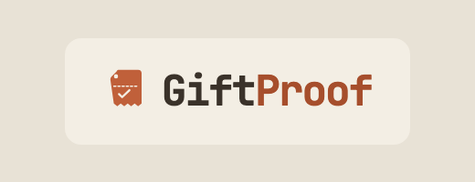
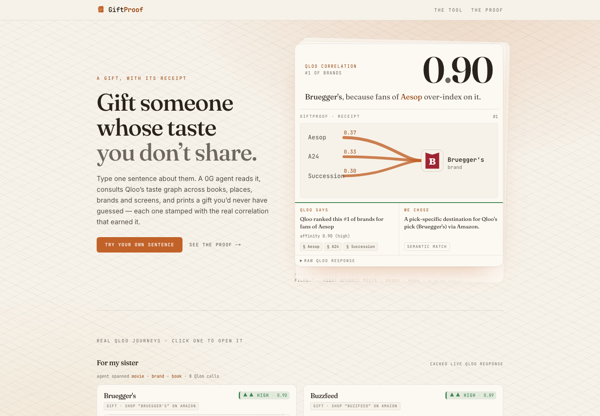
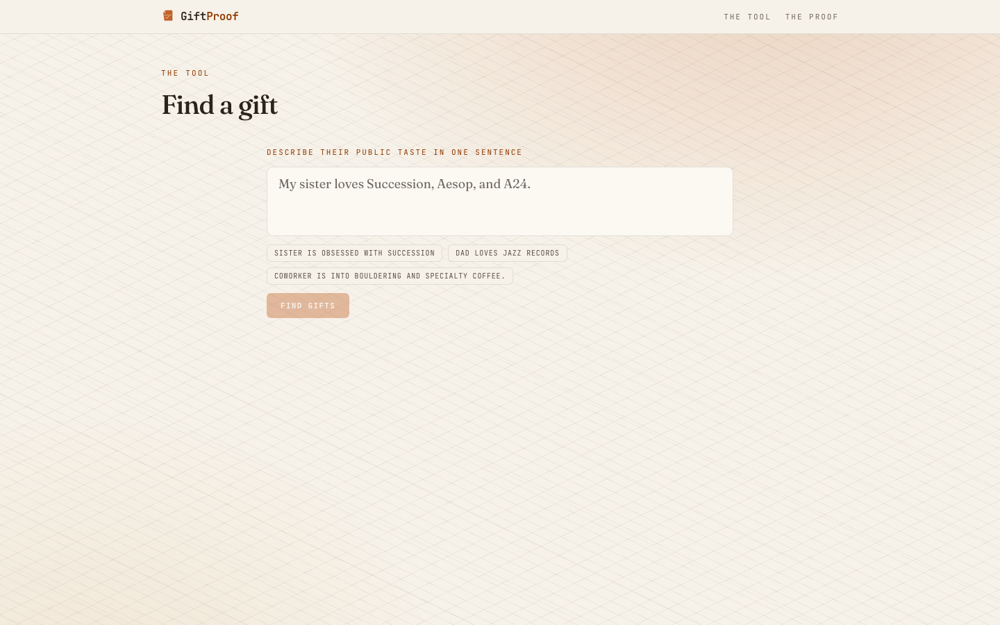
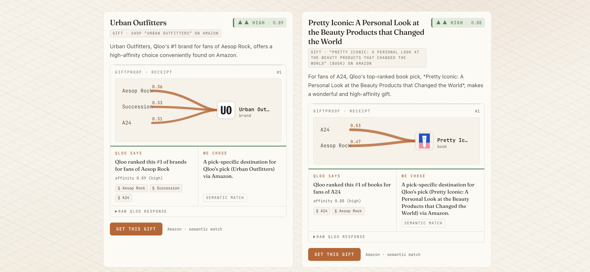

<p align="center">
  
</p>

# GiftProof

**The gift agent that reads a stranger's taste.** Type one sentence about someone ("my sister is obsessed with Succession, Aesop, and A24") and GiftProof uses Qloo's cross-domain taste graph to rank gifts they will actually want, each with a receipt showing exactly why Qloo chose it.


**Live demo:** https://giftproof-app.vercel.app

Built for the Qloo Agentic Hackathon ("Agents, but with taste.").

---

## The product

**1 · The pitch, with the proof.** The hero shows the real Qloo correlation as the headline number
(`0.90`), crowning a live receipt whose cross-domain bridge draws from the real explainability
contributors (Aesop · A24 · Succession) to the pick (Bruegger's).



**2 · One sentence in.** Describe someone's public taste in a single sentence (or tap a sample).



**3 · Ranked gifts, each with its receipt.** Every card leads with the Qloo pick (the cross-domain
surprise), tags the buyable gift, carries a real product/brand image where the leap lands, and shows
the "Qloo says / we chose" receipt. Remove or add a taste chip and the whole grid re-prints live.



> **Honesty invariants bind the UI:** every number on screen is a real Qloo field (affinity,
> explainability score, rank). No fabricated percentages, no PII sent to Qloo, degraded states are
> labelled (never a blank grid dressed as Qloo-powered), and aggregate framing only
> ("fans of X over-index on Y") — the proof is on `/proof` with the raw response.

---

## How GiftProof uses Qloo

Qloo is not a decoration here. It does the one piece of work the giver cannot do themselves: bridge a taste gap by correlating one kind of taste (a show, a brand, a studio) to a *giftable* kind of thing, ranked by real shared-audience affinity. Delete the Qloo call and the picks are empty. The LLM never ranks.

| Capability | Qloo surface | Call site |
|---|---|---|
| Resolve each taste to a real Qloo entity ID | `GET /search` | `src/lib/qloo/resolve.ts:14` |
| Sharpen a broad taste into a Qloo tag signal | `GET /v2/tags` | `src/lib/qloo/resolve.ts:22` |
| Rank giftable entities by cross-domain affinity (the differentiator) | `GET /v2/insights` with `signal.interests.entities` | `src/lib/qloo/insights.ts:69` |
| Explain *which* seed taste drove each pick | `feature.explainability=true` on `/v2/insights` | `src/lib/qloo/insights.ts:69`, `src/lib/qloo/provenance.ts` |
| Keyless host liveness | `GET /search?query=A24` | `src/app/api/health/route.ts:17` |

**The hero query** (one real journey, redacted key) ranks 12 brand picks for the sister/Succession sentence across 3 agent-chosen domains using 8 total Qloo calls (5 resolution plus a 3-domain parallel insights fan-out). Every number is recomputable from committed real Qloo output by `npm run verify-claims` (see [CLAIMS.md](CLAIMS.md) and [submission/proof.md](submission/proof.md)).

---

## What is GiftProof

Buying a gift for someone whose taste you cannot guess (a parent, an in-law, a new partner) is a near-universal, recurring problem. Keyword search and a generic LLM both collapse to the *giver's* taste bubble or a safe cliche. GiftProof reads only public taste and lets Qloo's behavioral affinity graph do the bridging.

It is an agent loop, not a single call:

1. **Extract.** The 0G Compute LLM reads the free-text sentence and pulls out the recipient's tastes plus 2 to 4 giftable domains to target. It extracts, it never ranks.
2. **Resolve.** Each taste is resolved to a real Qloo entity ID via `/search` (or sharpened to a tag via `/v2/tags`). No recipient names or PII are ever sent to Qloo.
3. **Rank cross-domain.** `/v2/insights` is fanned out across the chosen domains in parallel, seeded with the resolved entities, and the picks are ordered by Qloo's real `query.affinity`. Qloo's numbers decide the order.
4. **Refine (gated).** If the first ranking is weak (low top affinity or thin explainability), the agent adds a tag signal and re-queries once. Sharp first results skip this hop to keep latency low.
5. **Resolve to a gift.** An entity-to-gift resolver maps each Qloo-chosen pick to a buyable product link or e-gift, keeping Qloo the chooser.
6. **Prove it.** Every pick carries a split **"Qloo says / we chose"** receipt built from Qloo's real explainability contributors, never a fabricated score. Swap a seed and the receipt recomputes live.

When 0G is unreachable the app degrades honestly (an `EXTRACTION_UNAVAILABLE` label, no faked agent output); when Qloo is unreachable it serves a last-good cached result or a labelled empty state. It never invents a pick.

---

## Architecture

```
  Giver (browser)                 GiftProof (Next.js 15, App Router)
  +---------------+               +------------------------------------------------+
  | one sentence  |-- POST ------>| /api/gift                                      |
  | about recip.  |               |   |                                            |
  +---------------+               |   v                                            |
         ^                        |  extract tastes + domains -- 0G Compute LLM    |
         | ranked gifts +         |   |                          (extract/narrate, |
         | "Qloo says / we chose" |   v                           never ranks)     |
         | receipt                |  resolve signals -- Qloo /search, /v2/tags     |
         |                        |   |                                            |
         |                        |   v                                            |
         |                        |  rank cross-domain -- Qloo /v2/insights        |
         |                        |   |   (+ feature.explainability)               |
         |                        |   v                                            |
         +------------------------|  entity -> gift resolver -> split receipt      |
                                  +------------------------------------------------+
```

Quota-frugal by design: an in-process `Semaphore(2)`, an LRU cache, request debounce, and stale-cache-on-429 keep the hackathon Qloo key within budget (see [SECURITY.md](SECURITY.md)).

---

## Tech stack

- **Framework:** Next.js 15 (App Router, React 19, TypeScript, Tailwind v4)
- **Taste engine:** Qloo Taste API (`/search`, `/v2/tags`, `/v2/insights` with explainability)
- **Agent LLM:** 0G Compute Router (OpenAI-compatible, `gemini-2.5-flash`) for extraction and narration only
- **Validation:** Zod on every API route
- **Infra:** `lru-cache`, a custom semaphore, no database (catalog JSON plus cache)

---

## Running locally

```bash
npm install
cp .env.example .env.local   # add your Qloo key + 0G Compute key
npm run dev                  # http://localhost:3000
```

The app runs without keys in a degraded, honest mode (the Qloo-ranked grid needs a live key to populate). See `.env.example` for every variable.

## Tests

```bash
npm test          # 71 unit + integration tests (vitest)
npm run typecheck # tsc --noEmit
npm run build     # next build
```

A separate live tier (`vitest.live.config.ts`, `npm run test:live`) exercises the real Qloo endpoints when a key is present. `npm run verify-claims` recomputes every headline number in [CLAIMS.md](CLAIMS.md) from committed real Qloo output and exits non-zero on any mismatch.

## API

All routes are Next.js App Router handlers under `src/app/api/`:

- `POST /api/gift` : one sentence in, ranked gifts plus receipts out (the main agent loop)
- `POST /api/swap` : swap one seed, recompute the ranking live
- `POST /api/narrate` : narrate a pick from Qloo's real explainability
- `GET /api/health` : host and credential liveness

## License

MIT. See [LICENSE](LICENSE).
